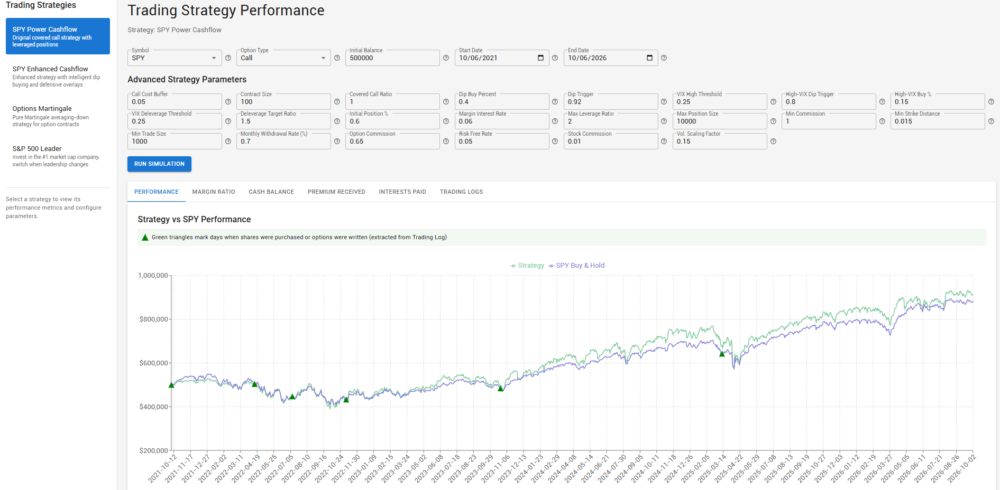

# TradingHub

TradingHub is a web app for backtesting trading strategies: pick a strategy, set its parameters and a
date range, and see the account balance, drawdown, trades and other results next to a buy & hold
benchmark.



## Strategies

The strategy code lives in the separate [algo_trading](https://github.com/anniesilver/algo_trading)
repo (path set by `ALGO_BASE_PATH`, default `C:/ALGO/algo_trading`). Each strategy's README there
explains how it works and every parameter the dashboard shows for it.

| Strategy | Id | What it does | Parameters |
|---|---|---|---|
| SPY Power Cashflow | `SPY_POWER_CASHFLOW` | SPY shares on margin, monthly covered calls, dip buying, monthly withdrawals | [SPY_POWER_CASHFLOW/README.md](https://github.com/anniesilver/algo_trading/blob/main/SPY_POWER_CASHFLOW/README.md) |
| Wheel | `WHEEL` | Cash-secured puts, then covered calls once assigned. Runs the same rules as trade-engine's paper bot (`algo_trading/shared/tradekit`) | [WHEEL/README.md](https://github.com/anniesilver/algo_trading/blob/main/WHEEL/README.md) |
| Options Martingale | `OPTIONS_MARTIN` | **In progress.** Buys options and averages down to a profit target. Being moved onto the shared rules; the current backtest is the older version | [OPTIONS_MARTIN/README.md](https://github.com/anniesilver/algo_trading/blob/main/OPTIONS_MARTIN/README.md) |
| S&P 500 Leader | `SPY500_LEADER` | Holds the #1 S&P 500 company by market cap and switches when leadership changes | [SPY500_LEADER/README.md](https://github.com/anniesilver/algo_trading/blob/main/SPY500_LEADER/README.md) |

SPY Enhanced Cashflow appears in the strategy menu, but the backend has no runner for it yet.

To add a strategy: put its code and a README with its parameters in algo_trading, add a runner in
`backend/services/` (see `strategy_service.py` and `wheel_service.py`), and add its form fields and
help text in `frontend/src/pages/Dashboard.js` and `parameterHelp.js`.

## Features

- **Backtests** over any date range, using market data from PostgreSQL and fetching from IBKR when the database has no data for the symbol or the range's start or end is missing (gaps inside the range are not filled)
- **Results:** account balance vs. buy & hold, annualized return, max drawdown, Sharpe ratio, trading logs,
  and strategy-specific cards (for example the Wheel summary)
- **Per-strategy settings** with help text on every field
- **API:** RESTful JSON endpoints for running simulations and refreshing market data

## Tech Stack

- **Backend**: Flask (Python)
- **Database**: PostgreSQL
- **Frontend**: React.js, Material-UI, Recharts
- **Market data**: Interactive Brokers (IB Gateway) and yfinance

## Installation

### Prerequisites

- Python 3.8+
- PostgreSQL
- pip (Python package manager)
- Node.js and npm (for frontend)

### Setup Instructions

1. **Clone TradingHub and the strategy repo**
   ```bash
   git clone https://github.com/anniesilver/TradingHub.git
   git clone https://github.com/anniesilver/algo_trading.git   # strategy code, see ALGO_BASE_PATH below
   cd TradingHub
   ```

2. **Install Python dependencies**
   ```bash
   make venv
   ```
   Alternatively, you can set up the virtual environment manually:
   ```bash
   python -m venv .venv
   # On Windows:
   .\.venv\Scripts\pip install -r requirements.txt
   # On Linux/Mac:
   ./.venv/bin/pip install -r requirements.txt
   ```

3. **Install frontend dependencies**
   ```bash
   cd frontend
   npm install
   cd ..
   ```

4. **Set up the database**
   ```bash
   # Create a PostgreSQL database
   createdb tradinghub
   ```

5. **Configure environment variables**

   Copy `backend/services/.env.example` to `backend/services/.env` and fill it in:
   - `DB_NAME`, `DB_USER`, `DB_PASSWORD`, `DB_HOST`, `DB_PORT`: the PostgreSQL database.
   - `ALGO_BASE_PATH`: where the algo_trading repo is checked out (default `C:/ALGO/algo_trading`).
   - `IBKR_HOST`, `IBKR_PORT`, `IBKR_SSH_TUNNEL`, `IBKR_CLIENT_ID`: the IB connection. IB Gateway
     (paper) runs on the trade-engine server. With `IBKR_HOST=127.0.0.1`, `IBKR_PORT=4002` and
     `IBKR_SSH_TUNNEL` set, the backend opens the SSH tunnel itself (needs key-based SSH login).

6. **Create the tables**
   ```bash
   python backend/init_all_db.py
   ```

## Running the Application

### Starting the Backend Server

1. **Start the API server**
   ```bash
   # On Windows:
   .\.venv\Scripts\python backend\simple_app.py

   # On Linux/Mac:
   ./.venv/bin/python backend/simple_app.py
   ```

   The backend server will run on http://127.0.0.1:8080

### Starting the Frontend Server

2. **Start the React frontend**
   ```bash
   cd frontend
   npm start
   ```

   The frontend will be available at http://localhost:3000 or http://localhost:3001

### Accessing the Application

- **Frontend:** http://localhost:3000 (or http://localhost:3001)
- **API Endpoints:**
  - API Test: http://localhost:8080/api/test
  - Strategies List: http://localhost:8080/api/strategies
  - Simulation Endpoint: http://localhost:8080/api/simulate (POST)
  - Wheel parameters (read from the shared rules): http://localhost:8080/api/strategies/WHEEL/params
  - IB connection test: http://localhost:8080/api/market-data/test-connection

## Troubleshooting

- **Dependency Issues:** If you encounter the scipy/numpy version mismatch error, try upgrading scipy to match your numpy version:
  ```bash
  ./.venv/Scripts/pip install scipy==1.15.2
  ```

- **'Config' object has no attribute 'SYMBOL' Error:** This error occurs when the strategy configuration does not have the required SYMBOL attribute. The backend code automatically applies the SYMBOL attribute from the frontend configuration, or falls back to 'SPY' as a default value if not provided.

- **Strategy import errors:** check that `ALGO_BASE_PATH` points at the algo_trading checkout and that
  it is up to date (`git pull`). The Wheel needs its `shared/` folder.

- **No history from IB (0 bars, timeouts):** check the IB Gateway messages on the trade-engine server.
  "2105 ... ushmds broken" means no US history; restart the Gateway's Docker container.

- **Port Conflicts:** If port 8080 or 3000 is already in use, check running processes and terminate any conflicting services.

## Common Settings

These fields apply to every strategy. Everything else on the form is strategy-specific: see the
strategy's README linked under [Strategies](#strategies).

- **Strategy**: which backtest to run.
- **Symbol**: the ticker. A new ticker is loaded from IB the first time, which can take a minute.
- **Start Date / End Date**: the period simulated.
- **Initial Balance**: starting cash (the Wheel uses its **Budget** instead).

### Unit conventions

Percentage inputs use familiar percentage values: enter `40` for 40%, `60` for 60%, or `1.5` for 1.5%.
The frontend configuration and API keep these as decimal fractions (`0.4`, `0.6` and `0.015`).

Exceptions:
- **Monthly Withdrawal Rate** (SPY Power Cashflow) uses percentage points in both the input and the
  API, so `1.0` means 1%, not 100%.
- Price thresholds (such as dip triggers) and leverage ratios are ratios, not percentages.
- VIX thresholds are the VIX level divided by 100, so `0.25` means VIX 25.

## Project Structure

```
backend/
  simple_app.py          Flask API server (port 8080)
  services/
    strategy_service.py  Loads and runs the algo_trading strategies
    wheel_service.py     Wheel backtest on algo_trading/shared/tradekit
    market_data.py       Database-first market data with IBKR fallback
    ibkr_*.py            IB connection, SSH tunnel and option data
  routes/                Auth, account, strategy and market-data routes
  models/                SQLAlchemy models
  tests/                 Backend tests
frontend/
  src/pages/Dashboard.js       Strategy forms and results
  src/pages/parameterHelp.js   Help text for every field
  src/services/                API calls
docs/images/             Screenshots
```
